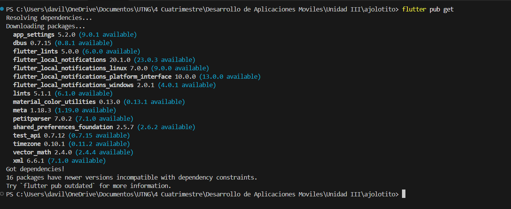
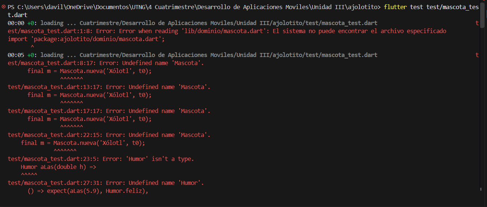
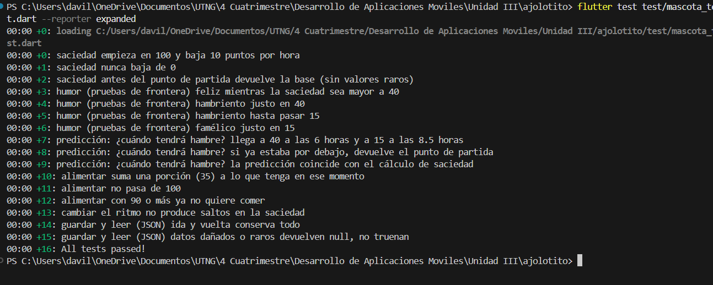
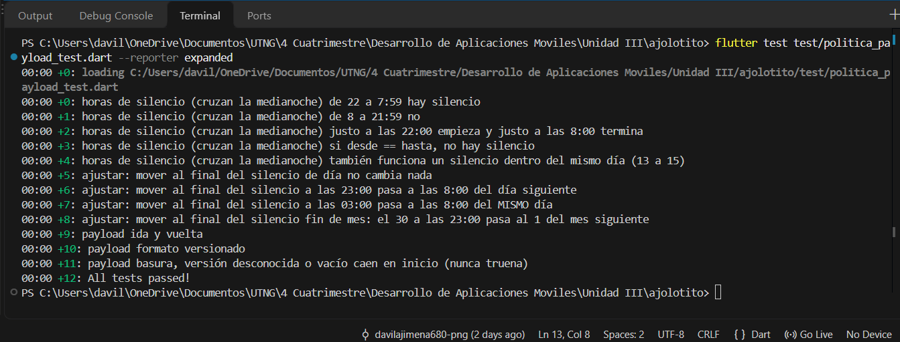
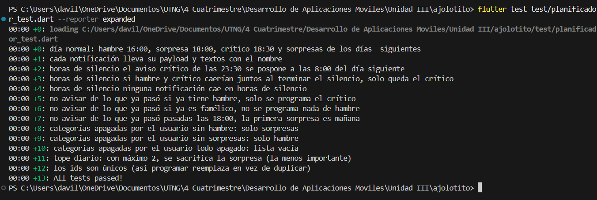
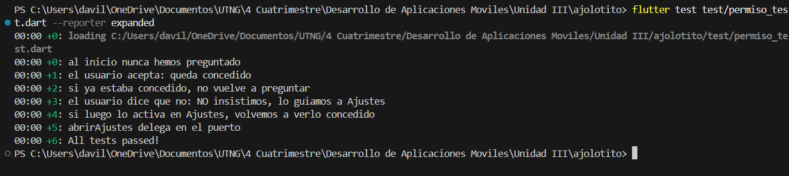
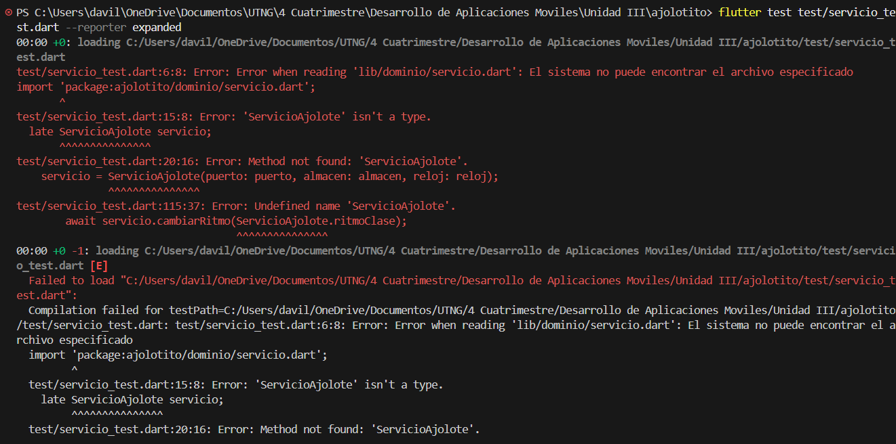
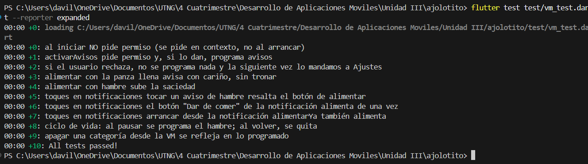
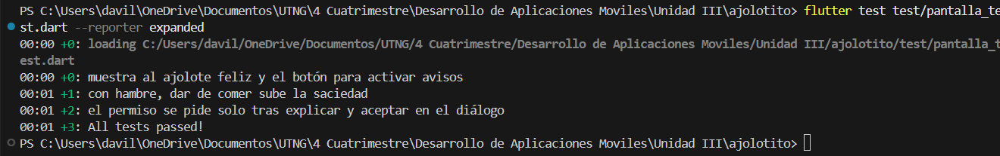

# Ajolotito Hambriento

## 1. Preparar el proyecto y dependencias

Configuración de dependencias (`flutter_local_notifications`, `timezone`, `shared_preferences`, `app_settings`) y permisos en Android e iOS

---

## 2. El reloj y el ajolote (`mascota.dart`)

Rojo: la prueba falla porque `Mascota` y `Humor` todavía no existen[cite: 7, 8].

Verde: se implementan `Reloj`, `Mascota` y `Humor` (saciedad, predicción de hambre, alimentar y guardado en JSON), y pasan las pruebas

---

## 4. Política de buena educación y payload (`politica.dart`, `payload.dart`)

Rojo: la prueba falla porque faltan `PoliticaNotificaciones` (horas de silencio de 22:00 a 08:00 y ajuste de horario) y `PayloadNotif`

Verde: se implementan `PoliticaNotificaciones` y `PayloadNotif` con validación de formato versionado (`v1:...`), y pasan las pruebas

---

## 6. El planificador (`planificador.dart`)

Rojo: la prueba falla porque `Planificador` e `Ids` todavía no existen

Verde: se implementa `Planificador` con IDs fijos, respeto a horas de silencio, ventana móvil de sorpresas y tope diario

---

## 8. Gestión de permisos (`gestor_permiso.dart`, `almacen.dart`)

Rojo: la prueba falla porque `GestorPermiso` y `Almacen` todavía no existen

Verde: se implementa `GestorPermiso` para pedir permiso en contexto una sola vez y guiar a Ajustes si se deniega

---

## 9. El servicio (`servicio.dart`)

Rojo: la prueba falla porque `ServicioAjolote` todavía no existe

Verde: se implementa `ServicioAjolote` para sincronizar el estado, reprogramar al alimentar y distinguir primer plano de segundo plano

---

## 11. ViewModel y pantallas (`ajolote_vm.dart`, `pantalla_ajolote.dart`)

Rojo: las pruebas del ViewModel y de los widgets de pantalla fallan porque todavía no existen

Verde: se implementan `AjoloteViewModel`, `DibujoAjolote`, `PantallaAjolote` y `PantallaAjustes`, y pasan las pruebas

---

## Suite completa de pruebas

Ejecución de `flutter test` con todas las pruebas unitarias y de widgets pasando en verde[cite: 47, 50].

